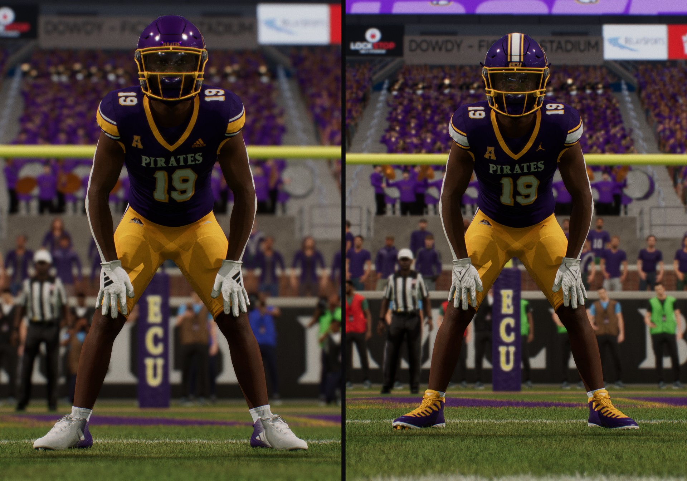
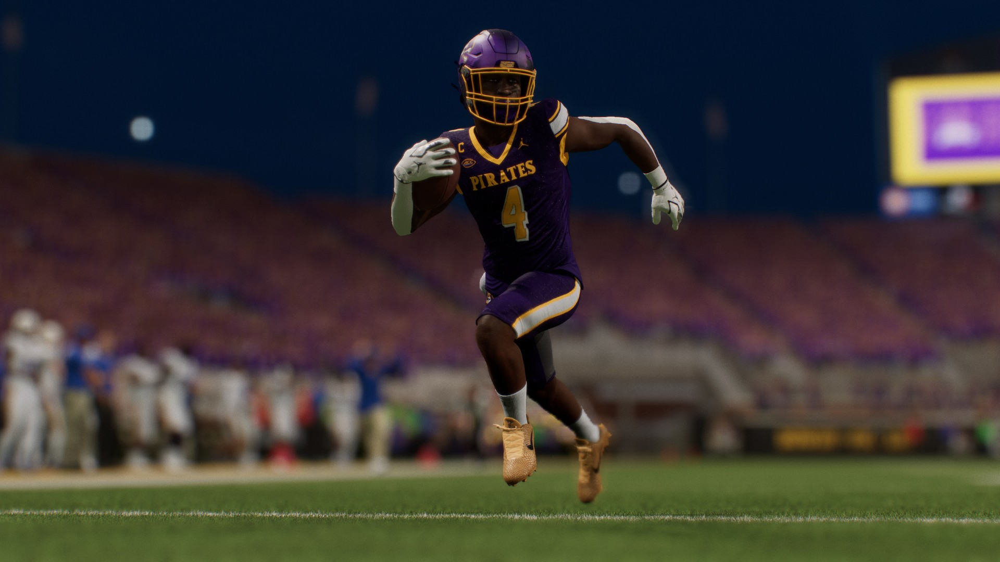
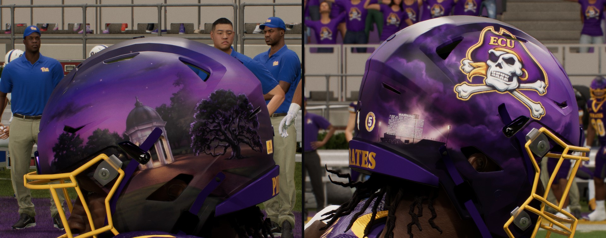
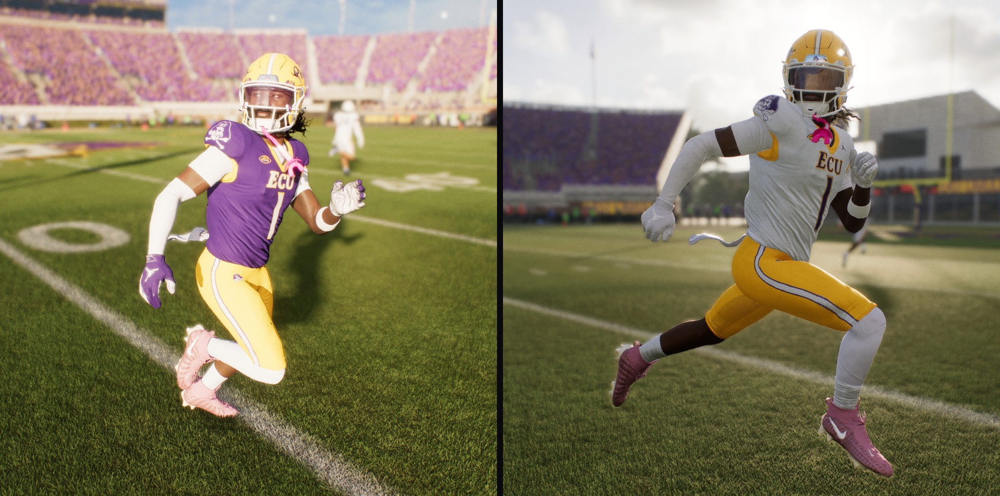
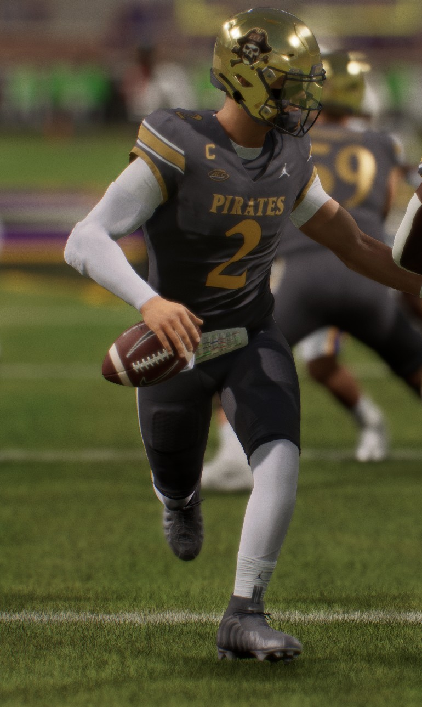
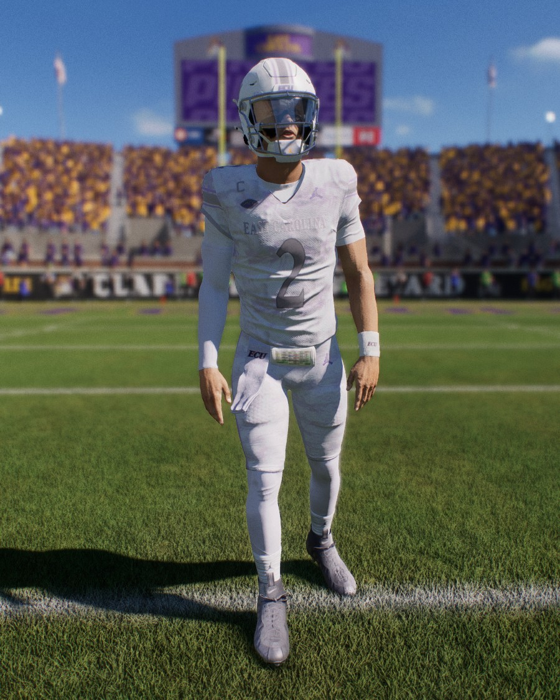
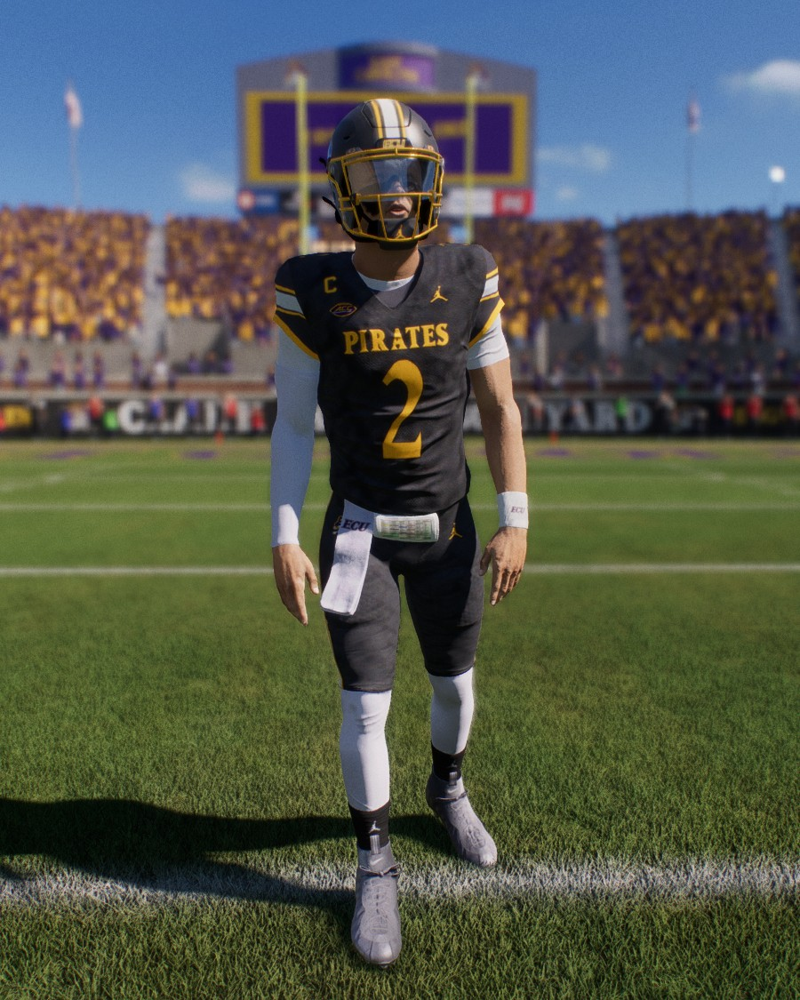
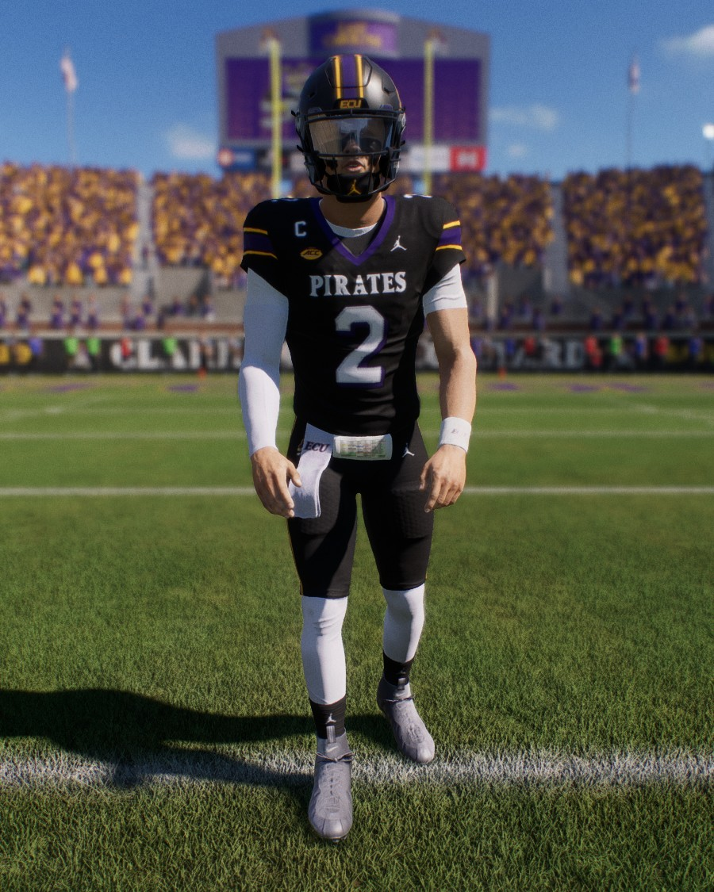
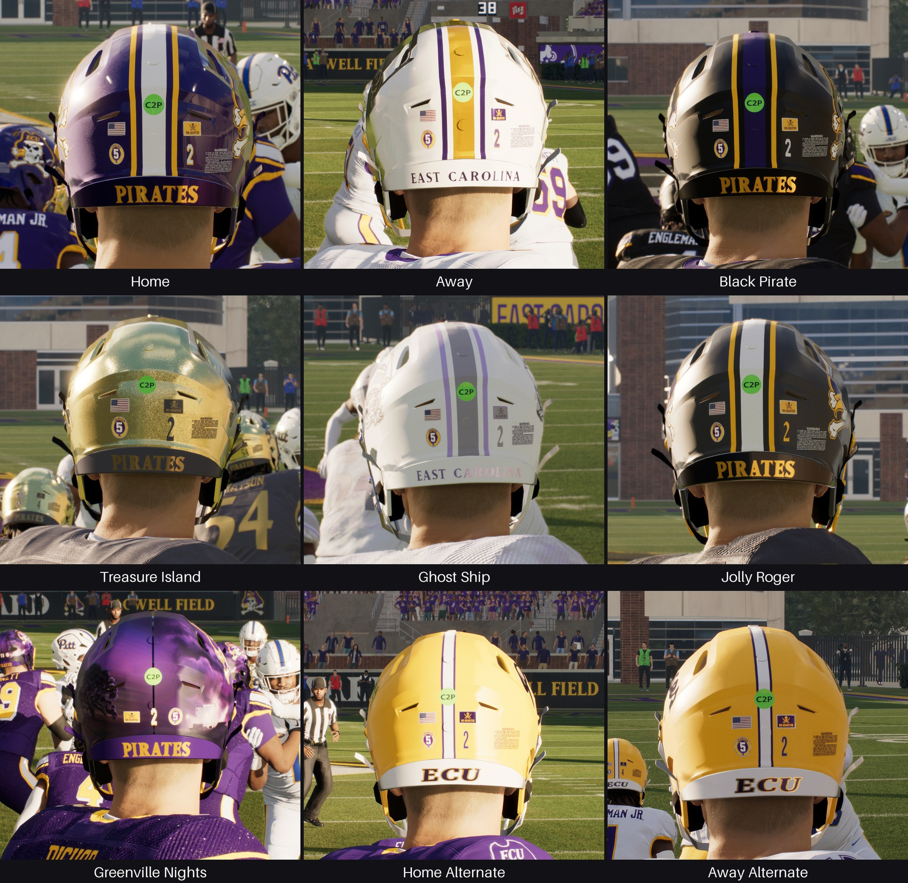
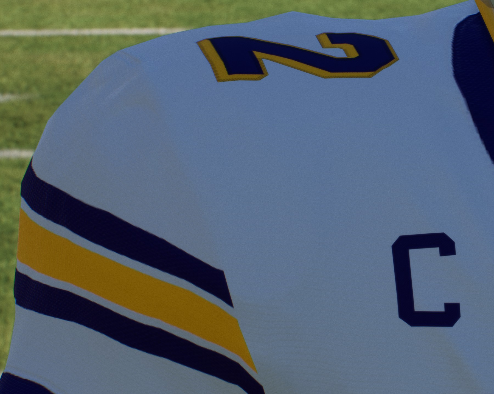

# ECU-Jordan-Redesign

A PC mod for EA SPORTS College Football 27 that switches East Carolina University from Adidas to Jordan Brand and adds six custom uniform sets and a reworked Black Pirate uniform, built through 19 tracked versions and released publicly to the College Football Modding Community from version 3.0.

## Components

- **scripts/** - Python build and texture tools that generate the mod's uniform assets: XML builders for each uniform, DDS encoders, a UV-map converter, procedural wordmarks, stripes, bumpers, and stickers
- **scripts/legacy/** - Experiments that did not ship, kept for reference (City Connect extras, a captain patch test, the extra uniform slot test, the 5.0 helmet rollback)
- **docs/technical-reference.md** - A reference covering the game's uniform asset chain, the bundle-loading rule, verified in-game behaviors, and a log of dead ends
- **docs/images/** - In-game screenshots used in this README
- **CHANGELOG.md** - Release notes for every version from 1.0 to 6.0

## About

- Designed and shipped a Frostbite-engine mod through 19 tracked versions, converting ECU from Adidas to Jordan Brand and building six custom uniforms (Jolly Roger, Treasure Island, Ghost Ship, Greenville Nights, Home Alternate, Away Alternate) and reworking Black Pirate with a matte helmet, triple stripes, a new helmet back, a PIRATES chest wordmark and a matching back bumper, with a rule that no two share a helmet, jersey, or pants.
- Did all engine-side work in Frosty Editor: navigating and exporting assets, duplicating pieces, registering new items in the game's 10,000-entry item registry by hand, and building uniform sets.
- Confirmed through in-game testing that a texture only renders if it is already in the bundles that piece loads, and made "duplicate a texture the piece already loads, then import new art into it" the core technique for every custom asset.
- Replaced the conference sticker with a custom "No Quarter" flag after noticing the sticker disappears when ECU changes conferences in dynasty, and verified the fix in two realigned dynasty saves.
- Worked out a compatibility fix with the author of a popular helmet mod, who added a check for this mod's brand setting, instead of breaking that mod's encryption.
- Built with Claude (Anthropic) as an AI pair-programmer. Claude wrote the Python tooling and format work. I designed the mod, did all engine-side editing in Frosty Editor, and tested every change in game.
- Demonstrates systematic debugging through hypothesis-driven testing, release management for a live community, and directing and reviewing AI-assisted development.

## Screenshots

ECU's Home uniform before and after the mod: on the left, Adidas logos, gloves and cleats, and on the right the Jumpman, Jordan gear and the 6.0 helmet stripes.

Greenville Nights, a City Connect-style uniform in midnight purple with a fine star speckle.

The Greenville Nights helmet. Each side is an airbrushed panel: the Cupola and a live oak on the left, a storm sky with the ECU logo and the stadium lights on the right.

Home Alternate and Away Alternate, a purple and white pair with satin gold helmets and gold pants. Home Alternate came from a community request.

Treasure Island, with a chrome gold helmet and a gunmetal jersey with satin gold numbers.

Ghost Ship, a white uniform with a gray and lavender fog print and a matte white helmet.

Jolly Roger, in charcoal with a topographic print and a gold, white and gold helmet stripe.

Black Pirate, the black uniform reworked with a matte helmet, a gold, purple and gold triple stripe, and a PIRATES chest wordmark.

Helmet backs for all nine uniforms. The No Quarter flag replaced the conference sticker, which the game removes from every helmet after a conference change in dynasty. I also added the Chris Johnson sticker ECU wears in real life to the back of every helmet.

The captain patch: only team captains wear the C.

## Built With

Frosty Editor (MMC Edition) | Frosty Mod Manager (MMC Edition) | Python | Pillow | NumPy | SciPy | OpenCV | Claude (Anthropic) | Google Gemini

## Setup

1. Download the latest release from the College Football Modding Community (CFMC) Discord.
2. Install it with Frosty Mod Manager (MMC Edition) and launch the game through the mod manager.
3. For Jordan gear on players, copy `ROSTER-ECUJORDAN` into `Documents\EA SPORTS College Football 27\saves` and load it from the main menu.
4. For dynasty files, use MyDynasty to change "Team Apparel" to "Jordan Brand".

The scripts are a record of how the mod was built, not a standalone tool. They read XML and images exported from Frosty Editor.

## Notes

This is an unofficial fan mod. It is not affiliated with EA, Nike, Jordan Brand, or East Carolina University, and this repository contains no game files or assets from EA or other mod authors.

The roster and team database changes required parsing and patching EA's binary formats. The technical reference describes that work, but the code is not published, because EA's user agreement prohibits reverse engineering.

New dynasties take team apparel from EA's online roster data, which no mod file can change, so the MyDynasty step is required.
